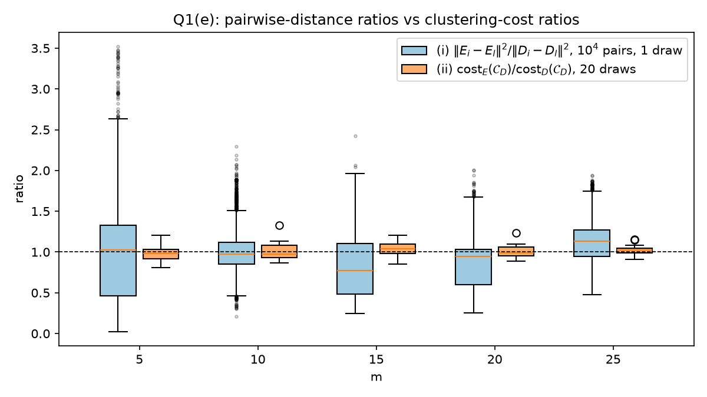

# CSE558 Assignment: JL for k-means and linear regression

Name: Sahaj Gupta, 2023459 (working alone)

AI assistance: Claude (AI assistant) was used for help with the code and explanations.

Code: _<GitHub link>_

All code is in `DSA1.ipynb`. Seeds are fixed (`SEED = 558` and offsets from it). Timings were measured on one machine (10-core laptop) and will differ on another.

## Data

Starting from 41 features, one-hot encoding gives 118 columns. Two of them are constant and get dropped: `num_outbound_cmds` and `is_host_login`.

**n = 494,021 rows, d = 116 columns.** rank(D) = 113. The rank is 3 less than d because each of the three one-hot groups adds up to 1 in every row. 80.3% of the connections are attacks.

---

## Q1: JL for k-means (k = 15, KMeans with n_init = 5)

### (a)

**cost(D, B) = 55,508.13.** sklearn's inertia is 55,505.83; the small gap is float32 rounding.
Wall-clock time of k-means on D: **2.63 s**.

### (b) and (c): cost ratios relative to cost(D, B), over 5 draws of A for each m

| m | B̂ mean | B̂ min | B̂ max | B⁺ mean | B⁺ min | B⁺ max |
|---|---|---|---|---|---|---|
| 5  | 1.122 | 1.010 | 1.295 | 76.69 | 73.77 | 78.25 |
| 10 | 1.057 | 0.974 | 1.138 | 73.53 | 71.57 | 75.95 |
| 15 | 0.993 | 0.969 | 1.025 | 69.82 | 66.91 | 72.00 |
| 20 | 1.012 | 0.968 | 1.072 | 66.03 | 64.89 | 67.75 |
| 25 | 1.007 | 0.973 | 1.109 | 62.92 | 60.43 | 67.17 |

cost(D, B̂) and cost(D, B⁺) for every run are in `results/q1_runs.csv`.

**(b)**
The ratio gets closer to 1 as m grows. At m = 5 the mean is 1.12 and the worst run is 1.29. From m = 15 onwards the mean is about 1.0. The gap between the best and worst run also gets smaller. Even with only 5 dimensions, the clustering is not much worse than the one on all 116 columns. This fits the JL result for k-means: the number of dimensions needed depends on k and the error we accept, not on n or d.

Some ratios are below 1. This means the clusters found on E gave a lower cost on D than k-means on D itself. k-means only finds a local minimum, so cost(D, B) is not the best possible cost. The run on E starts from different points in a different space, and sometimes it lands in a better local minimum. So a ratio below 1 says that the run in (a) was not optimal.

**(c)**
I would use B̂. Its cost is within 12% of the full k-means. B⁺ is 60 to 77 times worse. The problem is that A⁺a always lies in the row space of A. That is only an m-dimensional subspace of ℝ^d. Every part of the true centre outside that subspace is lost, so the centres end up far from the data. B̂ keeps the clusters found on E but averages the original rows of D. That gives a real centre in ℝ^d. It costs only one extra pass over D.

### (d) Mean time to draw A, compute E = DAᵀ and run k-means on E

| m | 5 | 10 | 15 | 20 | 25 | k-means on D (a) |
|---|---|---|---|---|---|---|
| time (s) | 1.07 | 1.14 | 1.27 | 1.30 | 1.43 | 2.63 |

The time goes up slowly with m. Each k-means step costs more when the points have more coordinates. At every m it is faster than running on D, about 2.5 times faster at m = 5. Some costs do not depend on the dimension, such as the k-means++ start and the 5 restarts. Computing E also takes time.

### (e) 10⁴ pairs (the same for all m) and 20 draws of A

| m | pairs: mean | pairs: std | cost ratio: mean | cost ratio: std | cost ratio: min–max |
|---|---|---|---|---|---|
| 5  | 0.937 | 0.495 | 0.974 | 0.093 | 0.81–1.21 |
| 10 | 1.025 | 0.304 | 1.004 | 0.109 | 0.86–1.33 |
| 15 | 0.814 | 0.328 | 1.031 | 0.092 | 0.85–1.20 |
| 20 | 0.900 | 0.277 | 1.008 | 0.078 | 0.89–1.23 |
| 25 | 1.087 | 0.232 | 1.025 | 0.060 | 0.91–1.15 |

The cost ratio in (ii) has the smaller spread. Its standard deviation is 3 to 5 times smaller than that of the pairwise ratios in (i) at every m.

A single pair can be stretched or shrunk a lot. For one pair, the ratio behaves like a chi-squared variable with m degrees of freedom, divided by m. Its standard deviation is √(2/m), which is 0.63 at m = 5 and 0.28 at m = 25. The values we measured are close to this. At m = 5 some pairs are stretched by more than 3 times.

The k-means cost is a sum over all 494,021 points. Some distances grow and some shrink, and these errors mostly cancel out. So the total stays close to its true value, and the ratio stays near 1.

Both spreads get smaller as m grows, roughly like 1/√m. In (i) the median also moves around, for example 0.77 at m = 15. This happens because all 10⁴ pairs use the same A. Many pairs point in similar directions because the data has many repeated attack rows, so they are stretched or shrunk together.

---

## Q2: JL for linear regression (CountSketch)

### (a)

**Loss(D, y, b) = 2,949.79.** Time to compute b with `numpy.linalg.lstsq`: **1.30 s**.

### (b) and (c): 5 CountSketches for each m

| m | mean Loss(D,y,ã) | mean ratio | min ratio | max ratio | mean sketched loss ‖SDã − Sy‖² | mean time (s) |
|---|---|---|---|---|---|---|
| 50   | 10,191 | 3.455 | 3.026 | 4.508 | ≈ 0 (9e-24) | 0.314 |
| 100  | 48,575 | 16.47 | 10.91 | 24.93 | ≈ 0 (2e-23) | 0.327 |
| 200  | 6,267  | 2.125 | 1.981 | 2.246 | 1,406.9 | 0.313 |
| 500  | 3,830  | 1.298 | 1.244 | 1.360 | 2,296.1 | 0.314 |
| 1000 | 3,315  | 1.124 | 1.103 | 1.162 | 2,533.4 | 0.316 |
| 2000 | 3,132  | 1.062 | 1.051 | 1.067 | 2,847.6 | 0.318 |
| 5000 | 3,022  | 1.024 | 1.020 | 1.029 | 2,887.4 | 0.322 |

Results for every run are in `results/q2_runs.csv`.

**(b)** Here rank(D) = 113.

Below the rank (m = 50 and 100), SD has fewer rows than the rank of D. So there is always an ã that fits the sketched data exactly, and the sketched loss is 0 up to rounding. But this ã is useless on the full data. The true loss is 3.5 to 16 times the best loss. It is worst at m = 100, just below the rank. There SD is almost square and badly conditioned, so the solution has very large entries.

Above the rank, the sketched problem has more equations than unknowns, and ã becomes a good estimate. The ratio drops quickly towards 1: 2.12 at m = 200, 1.30 at m = 500 and 1.02 at m = 5000. The numbers follow roughly 1 + 113/(m − 113). For m = 500 this gives 1.29, and we got 1.30.

The sketched loss is always smaller than the true best loss of 2,950, because ã is chosen to fit the sketched data. As m grows it rises towards 2,950. At m = 500 it is 2,296, and at m = 5000 it is 2,887. So a small sketch makes the fit look better than it really is.

**(c)**
Drawing S, forming SD and Sy and solving for ã takes about 0.31 to 0.32 s for every m. Computing b on the full data takes 1.30 s, so the sketch is about 4 times faster. The time barely changes with m. Most of it is the single pass over the 494,021 rows to build SD. After that, the small m × 116 problem is quick to solve, even at m = 5000.

### (d) ‖Sv‖²/‖v‖² over 100 CountSketches of the residual v = Db − y

| m | mean | std | min | max | √(2/m) |
|---|---|---|---|---|---|
| 50   | 0.993 | 0.186 | 0.621 | 1.597 | 0.200 |
| 500  | 1.004 | 0.062 | 0.875 | 1.198 | 0.063 |
| 5000 | 1.001 | 0.020 | 0.955 | 1.039 | 0.020 |

The mean is about 1 for every m, because CountSketch keeps the squared length correct on average. The spread shrinks as m grows. The standard deviation is 0.186 at m = 50, 0.062 at m = 500 and 0.020 at m = 5000. Each 10 times increase in m cuts it by about √10 ≈ 3.2. This matches √(2/m). At m = 50 the ratio ranges from 0.62 to 1.60. At m = 5000 it stays between 0.96 and 1.04.

### (e) 50,000-row subset, m = 500, 5 repetitions

Loss(D′, y′, b′) = 203.16.

| sketch | mean time to draw S and form SD′, Sy′ (s) | mean ratio | min–max ratio |
|---|---|---|---|
| CountSketch | 0.030 | 1.295 | 1.267–1.314 |
| Dense Gaussian | 0.112 | 1.287 | 1.248–1.335 |

Both sketches give almost the same accuracy, with a ratio of about 1.29. CountSketch is about 4 times faster on this subset. On the full D the difference would be much larger. A dense Gaussian S would have 500 × 494,021 ≈ 247 million entries, about 2 GB in float64. Computing SD would take about 3 × 10¹⁰ operations. CountSketch only needs one bucket and one sign per row, and one pass over D. So I would use CountSketch on the full D. It is just as accurate and much cheaper in time and memory.
